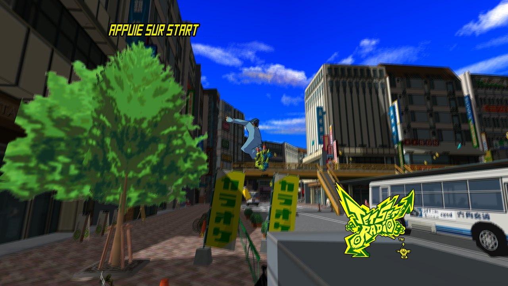
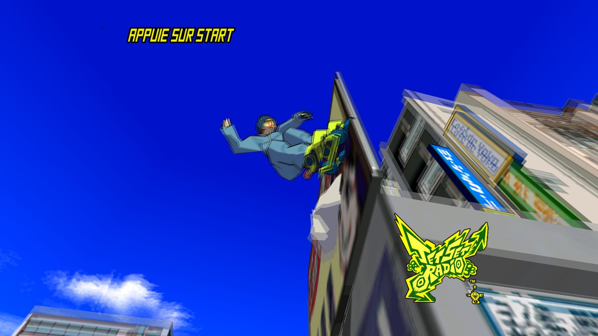
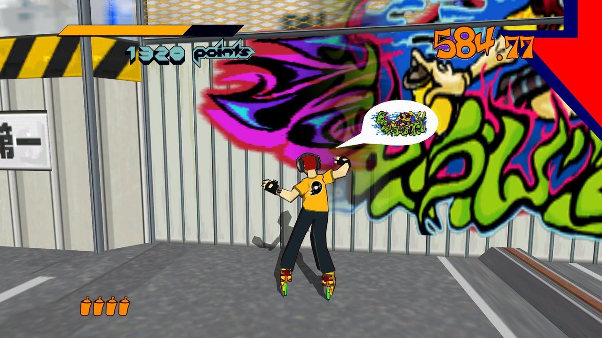

<p align="center">
  
</p>

<h1 align="center">Jet Set Radio 60 FPS</h1>

<p align="center">
  <b>Le Jet Set Radio de Steam, fluide à 60 images par seconde.</b><br>
  Un patch à installer en un clic, sans toucher aux fichiers du jeu.
</p>

<p align="center">
  <a href="https://github.com/yozencolere/JetSetRadio-60FPS/releases/latest"><b>⬇️ Télécharger la version 1.0.1</b></a>
  &nbsp;·&nbsp;
  <a href="https://yozencolere.github.io/JetSetRadio-60FPS/">Page de présentation</a>
</p>

---

## Ce que ça change

| | |
|---|---|
| 🎞️ **60 images par seconde** | Le jeu tourne à 30 FPS d'origine. Le patch fait calculer par le moteur du jeu une image intermédiaire entre chaque image : positions, rotations et animations sont réellement interpolées, pas juste mélangées. |
| 🌀 **Flou de mouvement (caméra)** | Un flou léger sur le décor quand la caméra bouge, comme une vraie caméra. Le perso, les passants et les voitures restent nets. 4 niveaux, au choix en jeu. |
| 🔍 **Textures nettes au loin** | Filtrage anisotrope x16 : fini le scintillement des textures lointaines. |
| 🏙️ **Plus de bâtiments qui surgissent** | Les bâtiments lointains et ceux du bord de l'écran sont affichés en permanence. |
| 🎨 **Tags corrigés** | Plus de voile blanc sur les graffitis selon l'angle de la caméra. |

<p align="center">
  
  
</p>

## Installation

1. Téléchargez **`Installer-JSR-60-FPS-v1.0.1.exe`** dans la [page de la version](https://github.com/yozencolere/JetSetRadio-60FPS/releases/latest).
2. Fermez le jeu, puis lancez l'installeur.
3. Il trouve Jet Set Radio tout seul (Steam). Cliquez sur **OK**.
4. Lancez le jeu normalement depuis Steam. C'est tout !

> Windows peut afficher « Windows a protégé votre ordinateur » car l'installeur n'est pas signé :
> cliquez sur **Informations complémentaires** puis **Exécuter quand même**.

**Installation manuelle** : téléchargez le `.zip`, puis copiez `d3d9.dll` dans le dossier du jeu
(à côté de `jetsetradio.exe`). Pour le trouver : clic droit sur le jeu dans Steam → *Gérer* → *Parcourir les fichiers locaux*.

## Touches en jeu

| Touche | Effet |
|:---:|---|
| **F1** | Flou de mouvement coupé |
| **F2** | Flou léger |
| **F3** | Flou intermédiaire |
| **F4** | Flou fort *(par défaut)* |
| **F8** | Couper / remettre tout le patch, pour comparer avec le jeu d'origine |

## Désinstallation

Relancez l'installeur et choisissez **Non** (désinstaller). Ou supprimez simplement `d3d9.dll` du dossier du jeu.
Le jeu redevient exactement comme avant.

## Questions fréquentes

**Est-ce que ça modifie le jeu ?** Non. Le patch est un seul fichier, `d3d9.dll`, que le jeu charge au démarrage.
Aucun fichier du jeu n'est modifié, et les sauvegardes ne sont pas touchées.

**Le jeu tourne-t-il plus vite ?** Non, la vitesse de jeu reste exactement la même : seules les images
affichées sont doublées.

**J'ai déjà un autre mod qui utilise `d3d9.dll`.** L'installeur le met de côté (`d3d9.dll.avant_jsr60`)
et le remet en place à la désinstallation. Les deux ne peuvent pas fonctionner en même temps.

**Version testée :** Jet Set Radio sur Steam (version PC de 2012), Windows 11.

---

<details>
<summary><b>Pour les curieux : comment ça marche</b></summary>

Le portage PC de 2012 reprend le moteur Dreamcast (bibliothèque Ninja de SEGA) : chaque modèle est
transformé par le processeur avec la matrice courante, puis rangé dans un grand tampon de sommets dessiné en
fin d'image. Le patch est une `d3d9.dll` intermédiaire qui :

- intercepte les 5 fonctions de dessin de modèle du jeu et dessine chaque modèle une seconde fois avec une
  matrice à mi-chemin entre l'image précédente et l'image actuelle (quaternions pour la rotation) ;
  le jeu calcule lui-même les sommets intermédiaires ;
- classe les dessins (réel / intermédiaire / commun) et rejoue l'image deux fois à chaque `Present` ;
- garde des tampons de travail séparés pour les articulations, refait les copies d'écran des effets du jeu
  dans le bon ordre, et apparie les instances d'un même modèle par position dans le monde ;
- pour le flou, dessine deux positions de plus par image et fait la moyenne ; les objets qui bougent dans le
  monde gardent la même position dans les deux, donc restent nets ;
- corrige quelques défauts du portage : tri des couches des tags, angle de vue 4:3 des objets, blocs de ville
  absents de la liste de visibilité de la zone, `MAXANISOTROPY` jamais réglé.

### Compiler

Visual Studio 2022 (outils C++ x86) :

```
build.cmd                       -> bin\d3d9.dll
installeur\build_installeur.cmd -> installeur\sortie\Installer JSR 60 FPS.exe
```

`outils/jsr.py` : petit désassembleur (pefile + capstone) utilisé pour étudier `jetsetradio.exe`.
</details>

*Jet Set Radio est une marque de SEGA. Projet de fan, non affilié à SEGA. Aucun fichier du jeu n'est inclus :
il faut posséder le jeu. Licence MIT.*
